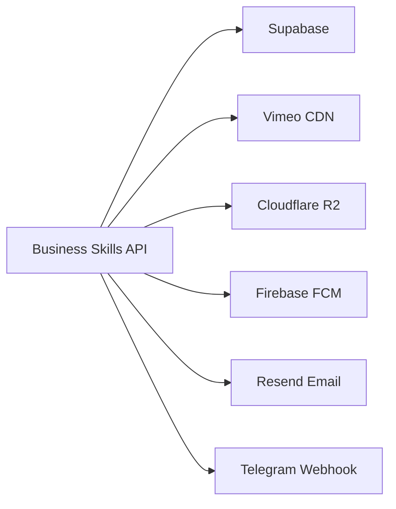
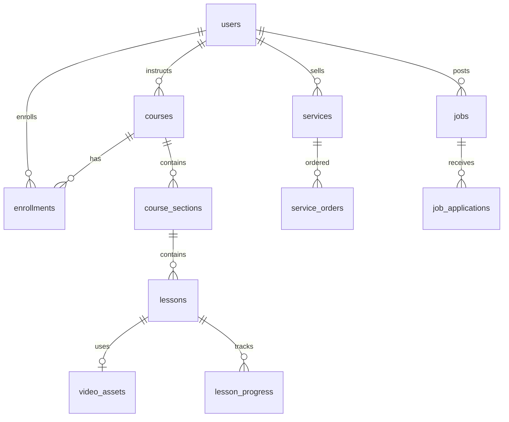

# Business Skills Platform — Project Roadmap & Technical Reference

**Document version:** 1.1  
**Last updated:** July 10, 2026  
**Audience:** Developers and technical leads  
**Formats:** `docs/PROJECT_ROADMAP.md` (source) · `docs/PROJECT_ROADMAP.pdf` (export)

---

## Table of Contents

1. [Platform Overview](#1-platform-overview)
2. [Completed Work Inventory](#2-completed-work-inventory)
3. [Pages Reference](#3-pages-reference)
4. [Routing & Navigation](#4-routing--navigation)
5. [Architecture & Structure](#5-architecture--structure)
6. [External Integrations](#6-external-integrations)
7. [Database Schema & Relationships](#7-database-schema--relationships)
8. [API Surface Summary](#8-api-surface-summary)
9. [Development & Operations](#9-development--operations)
10. [Future Roadmap & Known Gaps](#10-future-roadmap--known-gaps)

---

## 1. Platform Overview

### 1.1 Identity

| Field | Value |
|-------|-------|
| **Official name** | Business Skills |
| **Short name** | BS Platform |
| **Legacy internal name** | EduWork (`eduwork` in `package.json`, some env keys) |
| **Primary audience** | Iraqi users — Arabic-first (RTL), English supported (LTR) |
| **Purpose** | Unified marketplace for **online education**, **job opportunities**, and **freelance services**, with certificates, instructor tools, and employer flows |

Brand colors and assets live in `src/lib/brand/constants.ts` (primary orange `#E57D17`, teal `#045F6B`).

### 1.2 Product Vision

Business Skills connects four stakeholder types on one platform:

| Stakeholder | Primary goals on the platform |
|-------------|------------------------------|
| **Students** | Discover courses, learn via video player, earn certificates, apply for jobs, order services, build CV/portfolio |
| **Instructors** | Create and publish courses, manage video content via studio, track progress, issue certificates |
| **Companies** | Post jobs, review candidates, affiliate with the platform |
| **Admins** | Moderate content, manage users, import jobs, monitor video providers and analytics |

### 1.3 Tech Stack

| Layer | Technology |
|-------|------------|
| Framework | Next.js 16 App Router, React 19, TypeScript 6 |
| Styling | Tailwind CSS v4, shadcn/ui, Framer Motion |
| i18n | next-intl v4 — locales `ar` (default), `en` |
| Database / Auth | Supabase Postgres, Auth, RLS, Realtime |
| Hosting | Vercel |
| Object storage | Cloudflare R2 (S3-compatible) |
| Video CDN | Vimeo (primary high-traffic delivery) |
| Desktop studio | Wails App (`Wails App/`) — FFmpeg, HLS, encryption |
| Push notifications | Firebase Cloud Messaging (FCM) |
| Email | Resend |


| Video playback | hls.js, Plyr, custom `BsPlatformVideoPlayer` |

| Testing | Vitest (unit), k6 (load tests) |

### 1.4 Core Product Modules

| Module | URL area | Status |
|--------|----------|--------|
| Public landing | `/{locale}/` | Complete — marketing-only (no anonymous catalog) |
| Auth | `/{locale}/login`, `/register`, etc. | Complete |
| Mandatory onboarding | `/{locale}/onboarding` | Complete (Option B) |
| Personalized home | `/{locale}/home` | Complete — role-based views |
| Course catalog & detail | `/{locale}/courses` | Complete — auth required via proxy |
| Learning player | `/{locale}/learn/{courseSlug}/{lessonSlug}` | Complete — mobile UX in progress |
| Certificates | `/{locale}/certificate/{code}` | Complete |
| Jobs board | `/{locale}/jobs` | Complete — scraping + company posts |
| Services marketplace | `/{locale}/services` | Complete |
| Instructor dashboard | `/{locale}/instructor/*` | Complete |
| Course studio (web) | `/{locale}/instructor/courses/{id}/studio/*` | Complete — some UI polish pending |
| Desktop video studio | `Wails App/` | Foundations complete |
| Admin panel | `/{locale}/admin/*` | Complete |
| Student dashboard | `/{locale}/dashboard/*` | Complete |
| CV builder | `/{locale}/cv-builder/*` | Complete |
| Community / talent | `/{locale}/community`, `/portfolio/{slug}` | Complete |

| Push notifications | In-app + FCM | Complete — Realtime must be enabled |


### 1.5 Request Lifecycle (High Level)

```
Browser request
    → src/proxy.ts (i18n + JWT RBAC + onboarding + maintenance)
    → Server Component page (src/app/[locale]/...)
    → Domain logic (src/lib/...)
    → Supabase client (server / admin / public)
    → Postgres + RLS
    → Optional external providers (Vimeo, R2, FCM, Resend)
```

All user-facing pages are **Server Components**; interactivity is delegated to client components in `src/components/`.

---

## 2. Completed Work Inventory

### 2.1 Authentication & Authorization

| Item | Location | Description |
|------|----------|-------------|
| JWT claims in `app_metadata` | `src/lib/auth/sync-user-claims.ts` | Role, `is_active`, onboarding fields projected from `public.users` |
| Claims-first proxy | `src/proxy.ts`, `src/lib/auth/proxy-rbac.ts` | Avoids DB hit on every navigation when claims are complete |
| Claims backfill script | `scripts/backfill-auth-claims.ts` | `npm run auth:claims:backfill` |
| Account suspended flow | `/account-suspended` | Inactive users blocked platform-wide |
| Role capabilities | `src/lib/auth/role-capabilities.ts` | Fine-grained permission helpers |
| Safe redirect | `src/lib/auth/safe-redirect.ts` | Validates `next` query param after login |

### 2.2 Onboarding (Option B — Mandatory)

| Item | Location | Description |
|------|----------|-------------|
| DB migration | `supabase/migrations/058_user_onboarding.sql` | `account_type`, goals, interests, discovery source, company/instructor intents |
| Backfill migration | `supabase/migrations/059_onboarding_backfill_existing_users.sql` | Existing users marked onboarding-complete |
| Onboarding UI | `src/components/onboarding/*`, `/onboarding` | Multi-step flow; instructor/company selections create **pending requests only** |
| Personalized home | `/home`, `src/components/home/*` | Student / Instructor / Company views after onboarding |
| Proxy gating | `proxy-rbac.ts` | Only landing + auth pages are public; everything else requires login + onboarding |

### 2.3 Video & Learning

| Item | Location | Description |
|------|----------|-------------|
| Multi-provider architecture | `src/lib/video-providers/` | Registry, factory, Vimeo + R2 live; stubs for Mux, Bunny, AWS, etc. |
| Secure playback | `src/lib/video/playback-session.ts` | Session cookies, TTL, revocation |
| Content protection | Migration `049`, `src/lib/video/encryption-keys.ts` | AES/HLS encryption, watermark, security logs |
| Custom player | `BsPlatformVideoPlayer.tsx` | hls.js + Plyr, progress events, mobile layouts |
| Lesson progress & bookmarks | Migrations `053`, `src/lib/courses/` | Watch position, completion %, timestamp bookmarks |
| Lesson Q&A | Migration `056`, studio QA page | Threaded student–instructor Q&A per lesson |
| Course preview player | `CoursePreviewPlayer.tsx` | Free-preview lessons on course detail |
| Desktop studio | `Wails App/` | FFmpeg transcoding, HLS packaging, bulk upload |


### 2.5 Jobs, Services, Community

| Item | Location | Description |
|------|----------|-------------|
| Job scraping | `src/lib/jobs/scraping/` | Telegram webhook, RSS/LinkedIn cron, structured parsing |
| Service marketplace | Orders, reviews, seller dashboard | Denormalized ratings via triggers |

| Public portfolio | `/portfolio/{slug}` | CV showcase, view analytics |

### 2.6 Operations & Quality

| Item | Command / path | Description |
|------|----------------|-------------|
| Typecheck | `npm run typecheck` | Required before build |
| Unit tests | `npm test` | Vitest — auth, onboarding, playback |
| DB wipe script | `npm run db:wipe` | Destructive — empties all public data + auth users |
| k6 load tests | `loadtest/k6/` | Public browsing, authenticated nav, mixed |
| Project memory docs | `docs/PROJECT_CONTEXT.md`, etc. | Developer onboarding |

### 2.7 Manual Steps Still Required (Operations)

| Task | Notes |
|------|-------|
| Apply migrations `058`, `059` | If not yet run in Supabase SQL Editor |
| `npm run auth:claims:backfill` | After migrations or role changes |
| Enable Supabase Realtime on `notifications` | Required for live notification bell |
| Re-seed after DB wipe | Course categories — see `supabase/scripts/wipe-all-data.sql` |

---

## 3. Pages Reference

**Conventions:**

- All URLs are prefixed with `/{locale}/` where `locale` ∈ `ar` | `en`.
- Route groups `(public)`, `(auth)`, `(student)`, `(instructor)`, `(with-shell)` do **not** appear in URLs.
- **Access** column reflects proxy rules in `src/lib/auth/proxy-rbac.ts` plus server-side guards in layouts.

---

### 3.1 Public Landing — `(public)`

#### `/{locale}/` — Marketing Landing

| | |
|---|---|
| **File** | `src/app/[locale]/(public)/page.tsx` |
| **Layout** | `[locale]/layout.tsx` (navbar, footer, brand splash) |
| **Access** | Public anonymous |

**Purpose:** Brand introduction and conversion to registration. Does **not** show course/job/service listings (auth-gated elsewhere per Option B).

**Features:**
- Hero section with primary CTA to register/login
- Trust / credibility section
- Ecosystem overview (education, jobs, services)
- Footer with links and brand assets

**Key functions:**
| Function | Description |
|----------|-------------|
| View landing content | Static/marketing server-rendered sections |
| Navigate to auth | Links to `/login`, `/register` |
| Locale switch | Via navbar — `ar` ↔ `en` |
| Signed-in redirect | Proxy redirects authenticated users to `/home` or `/admin` |

**Key components:** `LandingHero`, `TrustSection`, `LandingFooter`, `Navbar`, `BrandSplashGate`

---

### 3.2 Authentication — `(auth)`

**Shared layout:** `src/app/[locale]/(auth)/layout.tsx` — split branding panel; redirects signed-in users away from auth pages.

#### `/{locale}/login`

| | |
|---|---|
| **File** | `src/app/[locale]/(auth)/login/page.tsx` |
| **Access** | Public anonymous |

**Features:** Email/password login, OAuth if configured, `next` param for post-login redirect.

**Functions:**
| Function | Description |
|----------|-------------|
| `LoginForm` submit | Supabase `signInWithPassword`; calls `resolvePostAuthRedirect()` |
| Forgot password link | Navigates to `/forgot-password` |
| Register link | Navigates to `/register` |
| Post-auth routing | Incomplete onboarding → `/onboarding`; complete → `/home` or role default |

#### `/{locale}/register`

**Features:** Account creation, email verification flow, terms acceptance.

**Functions:**
| Function | Description |
|----------|-------------|
| `RegisterForm` submit | Creates `auth.users` + trigger inserts `public.users` |
| Email uniqueness check | `/api/auth/check-email` |
| Welcome email | `/api/auth/welcome` (optional) |
| Post-register | Redirect to onboarding (new users have `onboarding_completed=false`) |

#### `/{locale}/forgot-password` · `/{locale}/reset-password` · `/{locale}/verify-email`

| Page | Functions |
|------|-----------|
| Forgot password | Sends Supabase password reset email |
| Reset password | Sets new password from recovery token |
| Verify email | Confirms email; resend verification option |

---

### 3.3 Post-Auth System Pages

#### `/{locale}/onboarding`

| | |
|---|---|
| **File** | `src/app/[locale]/onboarding/page.tsx` |
| **Access** | Authenticated; exempt while onboarding incomplete |

**Purpose:** Mandatory first-run experience collecting account type, goals, and preferences.

**Features:**
- Account type selection: student / instructor / company
- Goal, skill level, interests, discovery source steps
- Instructor intent → creates `instructor_requests` (pending, no role elevation)
- Company intent → creates `company_affiliation_requests` (pending)
- Progress persistence in `users.onboarding_*` columns

**Functions:**
| Function | Description |
|----------|-------------|
| `OnboardingFlow` steps | Multi-step wizard with validation (`src/lib/onboarding/schema.ts`) |
| `completeOnboarding` action | Writes DB, syncs JWT claims, redirects to `/home` |
| Skip blocked | Proxy forces return until `onboarding_completed=true` |

#### `/{locale}/home` — Personalized Home

| | |
|---|---|
| **File** | `src/app/[locale]/home/page.tsx` |
| **Component** | `PersonalizedHome` → `StudentHomeView` \| `InstructorHomeView` \| `CompanyHomeView` |
| **Access** | Authenticated + onboarding complete; admins redirect to `/admin` |

**Features by account type:**

| View | Features |
|------|----------|
| **Student** | Continue learning, recommendations, quick links to courses/jobs/CV |
| **Instructor** | Course stats, studio shortcuts |
| **Company** | Job posting shortcuts, affiliation status, candidate tools |

#### `/{locale}/account-suspended`

Shows inactive account message. Set when `users.is_active=false`. Proxy blocks all other routes.

#### `/{locale}/maintenance`

Platform maintenance page. Non-admins redirected here when `platform_settings.maintenance_mode=true`.

---

### 3.4 Course Catalog & Detail

#### `/{locale}/courses` — Course Catalog

| | |
|---|---|
| **File** | `src/app/[locale]/courses/page.tsx` |
| **Access** | Authenticated (proxy) |

**Features:** Grid/list of published courses, category filters, search, sorting, pagination, ISR via `revalidate`.

**Functions:**
| Function | Description |
|----------|-------------|
| Browse published courses | Query `courses` where `status='published'` |
| Filter by category | Uses `course_categories` table |
| `CourseCard` navigation | Links to `/courses/{id}` |
| Global search integration | Navbar `GlobalSearch` |

#### `/{locale}/courses/{id}` — Course Detail

| | |
|---|---|
| **File** | `src/app/[locale]/courses/[id]/page.tsx` |
| **Access** | Authenticated |

**Features:**
- Course hero: title, instructor, rating, level, language, thumbnail
- Curriculum outline (`CourseCurriculum`) — sections and lessons; preview lessons marked
- Reviews (`CourseReviews`)
- Enrollment sidebar (`CourseEnrollSidebar`) — enroll CTA
- Preview video player (`CoursePreviewPlayer`) for free-preview lessons
- SEO: `generateMetadata`, JSON-LD structured data
- Recommendations banner

**Functions:**
| Function | Description |
|----------|-------------|
| `getCourseDetail` | Full course + sections + lessons + instructor |

| Enroll | Creates enrollment when eligible |
| Start learning | Links to `/learn/{courseSlug}/{lessonSlug}` if enrolled |
| Wishlist toggle | Adds/removes `course_wishlists` row |

---

### 3.5 Learning Player — `(student)/learn`

#### `/{locale}/learn/{courseSlug}/{lessonSlug}`

| | |
|---|---|
| **File** | `src/app/[locale]/(student)/learn/[courseSlug]/[lessonSlug]/page.tsx` |
| **Layout** | `learn/[courseSlug]/layout.tsx` — `LearnWorkspaceLayout`, curriculum sidebar |
| **Access** | Enrolled student, course instructor, or admin |

**Purpose:** Primary learning experience — video-first with tools panel.

**Features:**
- **Lesson types:** video, PDF/document, article (HTML), quiz, assignment, external link, download
- Video: `LessonVideoPlayer` → `BsPlatformVideoPlayer` with provider-aware playback
- Document: `LessonDocumentViewer`
- Quiz: `LessonQuizPlayer`
- Curriculum sidebar (`LessonLearningSidebar`) — progress indicators
- Mobile: `LearnMobileHeader`, `LearnMobileCurriculumSheet`, `LessonMobileActionBar`
- Tools panel: notes, Q&A
- Lesson navigation: prev/next within course
- Progress auto-save via `/api/courses/.../playback/progress`

**Functions:**
| Function | Description |
|----------|-------------|
| `resolveLearnRoute` | Resolves slug → IDs; canonical URL redirects |
| `getLessonCourseShell` | Enrollment check, sections, progress % |
| `getLessonContent` | Lesson data + access control (preview vs enrolled) |
| `GET .../playback` | Returns playback URL/session for current provider |
| `POST .../playback/progress` | Saves watch position and completion |
| `POST .../playback/events` | Analytics/security events |
| Bookmark at timestamp | `lesson_bookmarks` via player UI |
| Q&A thread | `lesson_qa_threads` / `lesson_qa_messages` |

---

### 3.6 Student Dashboard — `(student)/dashboard`

**Layout:** `DashboardShell` with workflow navigation (`src/lib/dashboard/`).

| URL | Purpose | Key functions |
|-----|---------|---------------|
| `/dashboard` | Overview | Continue learning cards, quick actions, workflow status |
| `/dashboard/my-learning` | Active enrollments | Progress bars, resume lesson links |
| `/dashboard/my-courses` | Purchased courses | Enrollment list, access course detail |
| `/dashboard/wishlist` | Saved courses | Add/remove wishlist, enroll from wishlist |
| `/dashboard/certificates` | Earned certificates | Download/share; links to `/certificate/{code}` |
| `/dashboard/profile` | Profile settings | Avatar, bio, skills, portfolio slug, preferences |
| `/dashboard/notifications` | Notification center | Mark read, filter by type; Realtime updates |
| `/dashboard/become-instructor` | Instructor application | Submit `instructor_requests` |
| `/dashboard/company-affiliation` | Company application | Submit `company_affiliation_requests` |
| `/dashboard/company-jobs` | Company's job posts | List, create, edit company-posted jobs |
| `/dashboard/company-jobs/new` | Create job | Job form with bilingual fields |
| `/dashboard/company-jobs/{id}/edit` | Edit job | Update posting, change status |
| `/dashboard/my-services` | Seller services | Manage service listings |
| `/dashboard/services/new` | Create service | Service listing form |
| `/dashboard/services/{id}/edit` | Edit service | Update pricing, portfolio images |
| `/dashboard/orders/my-orders` | Orders as buyer | Service order history |
| `/dashboard/orders/incoming` | Orders as seller | Fulfill, update status |
| `/dashboard/orders/{orderId}` | Order detail | Requirements, messages, status timeline |

---

### 3.7 Instructor Area — `(instructor)`

**Outer layout:** pass-through. **Shell layout** (`InstructorShell`): nav for dashboard, courses, studio.

#### Instructor Dashboard Pages

| URL | Purpose | Key functions |
|-----|---------|---------------|
| `/instructor` | Overview | Course count, pending actions |
| `/instructor/courses` | Course list | Filter by status; links to studio |
| `/instructor/courses/new` | Create course | Course wizard — draft creation |


| `/instructor/certificate-requests` | Certificate queue | Review final exam submissions |

#### Course Management

| URL | Purpose |
|-----|---------|
| `/instructor/courses/{id}` | Course hub — links to studio sections |
| `/instructor/courses/{id}/edit` | Redirect → `/studio` |

#### Course Studio — `/instructor/courses/{id}/studio/*`

**Layout:** Studio sidebar with section navigation.

| Studio page | Purpose | Key functions |
|-------------|---------|---------------|
| `/studio` | Overview | Publish status, quick stats |
| `/studio/information` | Metadata | Title, description, category, level, SEO, thumbnail |
| `/studio/curriculum` | Curriculum | Sections, lessons, reorder, lesson types |
| `/studio/resources` | Resources | Upload PDFs/files; download vs visit mode |
| `/studio/assignments` | Assignments | Create assignments, due dates, points |
| `/studio/quizzes` | Quizzes | Questions, correct answers, attempts |
| `/studio/qa` | Q&A moderation | Reply to student lesson questions |
| `/studio/reviews` | Reviews | View and reply to course reviews |
| `/studio/students` | Enrollments | Student list, progress overview |
| `/studio/certificates` | Certificates | Enable certs, final exam PDF, passing criteria |
| `/studio/analytics` | Analytics | Views, completion per course |
| `/studio/settings` | Settings | Price, publish/unpublish, rejection notes, video provider override |

**Studio API backing:** `/api/studio/cms/*`, `/api/studio/upload/*`, `/api/instructor/courses/{id}/videos/*`

---

### 3.8 Admin Panel — `/admin`

**Layout:** `AdminSidebar` + header; `requireAdminAccess` guard.

| URL | Purpose | Key functions |
|-----|---------|---------------|
| `/admin` | Dashboard | Platform KPIs, recent activity |
| `/admin/users` | User management | Search, role change, activate/suspend, claims sync |
| `/admin/courses` | All courses | Moderate, publish, reject |
| `/admin/courses/new` | Admin-created course | Assign instructor, create on behalf |
| `/admin/categories` | Categories | CRUD `course_categories` |
| `/admin/services` | Services | Moderate marketplace listings |
| `/admin/services/new` | Create service | Admin-created service |
| `/admin/services/{id}/edit` | Edit service | |
| `/admin/jobs` | Jobs | CRUD platform jobs |
| `/admin/jobs/new` | Create job | |
| `/admin/jobs/{id}/edit` | Edit job | |
| `/admin/jobs/{id}/candidates` | Applicants | View applications |
| `/admin/jobs/imported` | Imported jobs | Review scraped jobs queue |
| `/admin/jobs/sources` | Job sources | Configure Telegram/RSS/LinkedIn sources |
| `/admin/instructor-requests` | Instructor apps | Approve/reject → role elevation |
| `/admin/company-requests` | Company apps | Approve/reject → role `company` |


| `/admin/analytics` | Platform analytics | Charts, trends |
| `/admin/video-analytics` | Video analytics | Playback sessions, security events |
| `/admin/video-providers` | Video providers | Enable/disable Vimeo/R2, health, costs |
| `/admin/community` | Community | User search, moderation |
| `/admin/notifications` | Push admin | Send broadcast notifications |
| `/admin/settings` | Platform settings | Maintenance mode, featured courses |

---

### 3.9 Marketplace Verticals

#### Jobs — `/{locale}/jobs` · `/{locale}/jobs/{id}`

**Features:** Active job listings, filters (city, type, skills), apply with CV upload, company-posted vs admin-posted jobs.

**Functions:** Browse jobs, view detail, submit `job_applications`, share job link.

#### Services — `/{locale}/services` · `/{locale}/services/{id}`

**Features:** Service catalog, seller ratings, portfolio images, order sidebar.

**Functions:** Browse services, view seller profile (`/sellers/{sellerId}`), place order → `service_orders`.

#### Community — `/{locale}/community`

**Features:** Talent directory, member search, public portfolios.

**Functions:** Search members, link to `/portfolio/{slug}`.

#### Sellers — `/{locale}/sellers/{sellerId}`

**Features:** Public seller profile, their services and ratings.

#### Portfolio — `/{locale}/portfolio/{slug}`

**Features:** Public CV/portfolio page, view counter, download CV.

**Functions:** `portfolio_views` analytics, slug validation, privacy settings from profile.

#### Certificate — `/{locale}/certificate/{code}`

**Features:** Public certificate verification and display with QR code.

**Functions:** Lookup by `certificates.verification_code`, show course/student/instructor names.

---

### 3.10 CV Builder — `/cv-builder`

| URL | Purpose | Key functions |
|-----|---------|---------------|
| `/cv-builder` | Profile list | List `cv_profiles` for current user |
| `/cv-builder/new` | Create CV | Template selection, blank profile |
| `/cv-builder/{profileId}/edit` | Edit CV | Sections editor, export PDF |

**API backing:** `/api/cv/*` — save, export, templates.

---

## 4. Routing & Navigation

### 4.1 URL Structure

```
/{locale}/                          → Landing (public)
/{locale}/login|register|...        → Auth (public)
/{locale}/onboarding                  → Onboarding (auth, exempt)
/{locale}/home                        → Personalized home (auth + onboarded)
/{locale}/dashboard/*                 → Student dashboard
/{locale}/learn/{courseSlug}/{lesson} → Learning player
/{locale}/instructor/*                → Instructor (role-gated)
/{locale}/admin/*                     → Admin (role-gated)
/{locale}/courses|jobs|services|... → Verticals (auth required)
```

### 4.2 Proxy Gate (`src/proxy.ts`)

**Matcher:** All routes except `/api/*`, `/auth/*`, `/_next/*`, static files.

**Decision order:**
1. Run `next-intl` middleware (locale detection/prefix)
2. Fast path: public anonymous route + no auth cookie → allow
3. `supabase.auth.getClaims()` → parse `app_metadata`
4. If claims incomplete → one `public.users` query + schedule claims backfill
5. Maintenance mode check → non-admins to `/maintenance`
6. `decideProxyAuth()` → allow or redirect

### 4.3 Route Classification

| Category | Routes | Behavior |
|----------|--------|----------|
| **Public anonymous** | `/`, `/login`, `/register`, `/forgot-password`, `/reset-password`, `/verify-email`, `/maintenance` | No login required |
| **Onboarding exempt** | Above + `/onboarding`, `/account-suspended` | Allowed while onboarding incomplete |
| **Protected** | Everything else | Login required |
| **Privileged** | `/admin/*`, `/instructor/*` | Role must match |
| **Onboarding gate** | All protected except exempt | Incomplete → `/onboarding` |

### 4.4 Redirect Rules

| Condition | Redirect |
|-----------|----------|
| Unauthenticated on protected route | `/{locale}/login?next={safePath}` |
| `is_active=false` | `/{locale}/account-suspended` |
| Authenticated on auth page, onboarding done | `/{locale}/home` (admin → `/admin`) |
| Authenticated on `/`, onboarding done | `/{locale}/home` or `/admin` |
| Onboarding incomplete on protected route | `/{locale}/onboarding` |
| Non-admin on `/admin/*` | `/{locale}/home` |
| Non-instructor on `/instructor/*` | `/{locale}/home` |
| Maintenance on, non-admin | `/{locale}/maintenance` |

### 4.5 Navigation Flow Diagram

```mermaid
flowchart TD
  A[Visitor] --> B{Has session?}
  B -->|No| C[Public: / or /login]
  B -->|Yes| D{is_active?}
  D -->|No| E[/account-suspended]
  D -->|Yes| F{onboarding_completed?}
  F -->|No| G[/onboarding]
  F -->|Yes| H{role}
  H -->|admin| I[/admin]
  H -->|instructor| J[/home InstructorHomeView]
  H -->|company| K[/home CompanyHomeView]
  H -->|student| L[/home StudentHomeView]
  G -->|complete| H
  C -->|register/login| G
```

### 4.6 Component Routing Map (Major Shells)

| Shell component | Wraps | Navigation source |
|-----------------|-------|-------------------|
| `Navbar` | Most public/authenticated pages | Courses, Jobs, Services, Community, Search, Profile menu |
| `DashboardShell` | `/dashboard/*` | Workflow nav: learning, orders, profile, company |
| `InstructorShell` | `/instructor/(with-shell)/*` | Courses, studio |
| Studio sidebar | `/instructor/courses/{id}/studio/*` | Studio section tabs |
| `AdminSidebar` | `/admin/*` | Full admin menu |
| `LearnWorkspaceLayout` | `/learn/{courseSlug}/*` | Curriculum sidebar, lesson list |
| `AuthBrandingPanel` | `(auth)/*` | Minimal — logo + tagline |

### 4.7 Post-Login Redirect Logic

`src/lib/onboarding/post-auth-redirect.ts` and `resolvePostAuthRedirect()` in login/register forms:

1. Validate `next` param (`safe-redirect.ts`)
2. If onboarding incomplete → `/onboarding`
3. If admin → `/admin`
4. Else → `/home`
5. Company/instructor-specific shortcuts available from personalized home views

---

## 5. Architecture & Structure

### 5.1 Layered Architecture

```
┌─────────────────────────────────────────────────────────────┐
│  Presentation                                               │
│  src/app/[locale]/*  ·  src/components/*                    │
├─────────────────────────────────────────────────────────────┤
│  Edge Gate                                                  │
│  src/proxy.ts — i18n, JWT RBAC, onboarding, maintenance     │
├─────────────────────────────────────────────────────────────┤
│  Domain Services                                            │
│  src/lib/* — auth, courses, video, jobs…    │
├─────────────────────────────────────────────────────────────┤
│  Data Access                                                │
│  src/lib/supabase/{server,client,admin,public}.ts           │
├─────────────────────────────────────────────────────────────┤
│  Persistence                                                │
│  Supabase Postgres + RLS (supabase/migrations/)             │
├─────────────────────────────────────────────────────────────┤
│  External Providers                                         │
│  Vimeo, R2, FCM, Resend   │
└─────────────────────────────────────────────────────────────┘
```

### 5.2 Repository Structure

| Path | Responsibility |
|------|----------------|
| `src/app/` | App Router — pages, layouts, API route handlers |
| `src/app/[locale]/` | All locale-prefixed user-facing routes |
| `src/app/api/` | ~100 REST endpoints (server-only business logic entry) |
| `src/components/` | UI components — `ui/` (shadcn), feature folders |
| `src/lib/` | Domain logic — no UI; reusable across pages and APIs |
| `src/types/` | Shared TypeScript interfaces |
| `src/locales/` | i18n message files (`ar.json`, `en.json`) |
| `src/i18n/` | next-intl routing and request config |
| `supabase/migrations/` | Ordered SQL migrations (001–059+) |
| `supabase/scripts/` | Operational SQL (e.g. data wipe) |
| `scripts/` | Node ops scripts (claims backfill, wipe, PDF gen) |
| `docs/` | Project documentation |
| `Wails App/` | Desktop video studio (Go backend + web frontend) |
| `loadtest/k6/` | Load test scripts |
| `public/` | Static assets (logo, manifest, icons) |

### 5.3 `src/lib/` Domain Modules

| Module | Responsibility |
|--------|----------------|
| `auth/` | Claims sync, proxy RBAC, session, role capabilities |
| `supabase/` | SSR/browser/admin/public clients, timeout fetch |
| `video/` | Playback sessions, HLS proxy, encryption, watermark |
| `video-providers/` | Provider registry, factory, Vimeo/R2 adapters, health |
| `video-studio/` | Studio constants and formatting |
| `storage/` | R2 S3 provider, presigned URLs, object keys |
| `playback/` | Player state machine, progress, analytics adapters |


| `onboarding/` | Schema, server actions, redirect logic |
| `courses/` | Detail, enrollment, lessons, progress, Q&A, wishlist |
| `instructor/` | Dashboard data, course wizard, studio helpers |
| `admin/` | Admin queries, platform settings, imports |
| `jobs/` | Listings, forms, scraping pipeline |
| `services/` | Marketplace, orders |
| `certificates/` | Issuance, final exams, verification |
| `cv/` | CV builder client/server mappers |

| `community/` | Members, search settings |
| `push/` | FCM registration, admin send, service worker script |
| `notifications/` | In-app bell, grouping, dispatch |
| `email/` | Resend templates |
| `profile/` | Profile merge, sanitization, score |
| `portfolio/` | Public portfolio data, slug validation |
| `company/` | Affiliation request actions |

| `search/` | Global search, query sanitization |
| `recommendations/` | Course recommendations cache |
| `rate-limit/` | Durable Postgres-backed rate limiting |
| `cache/` | Listing cache invalidation |
| `brand/` | Brand constants |
| `seo/` | Metadata builders, Open Graph |

### 5.4 Supabase Client Strategy

| Client | When to use |
|--------|-------------|
| `createClient()` (server) | Authenticated server components and actions — respects RLS |
| `createClient()` (browser) | Client components needing user session |
| `createPublicClient()` | Cookieless reads inside `unstable_cache` for ISR |
| `createAdminClient()` | **Server only** — bypasses RLS; claims sync, admin APIs |

**Rule:** Never expose service role key to the browser.

### 5.5 Auth & Claims Architecture

```
public.users (canonical source of truth)
        │
        ▼ syncUserAuthClaims()
auth.users.raw_app_meta_data (JWT projection)
        │
        ▼ getClaims() in proxy
decideProxyAuth() — O(1) authorization without DB
```

**Claims:** `role`, `is_active`, `profile_status`, `account_type`, `onboarding_completed`, `onboarding_completed_at`, `claims_version`, `claims_updated_at`

**Never authorize from `user_metadata`.**

### 5.6 Caching & Performance

| Pattern | Use case |
|---------|----------|
| `unstable_cache` + public client | Course catalog, landing sections |
| JWT claims-first proxy | Avoid per-navigation `users` lookup |
| `revalidate` on pages | Course detail (300s), listings where cookieless |
| Maintenance flag TTL | 30s in-memory cache in proxy |

**Risks:** R2 HLS proxied through Next.js servers; authenticated query fan-out. See `docs/PERFORMANCE_AUDIT.md`.

### 5.7 i18n Architecture

- **Library:** next-intl v4
- **Config:** `src/i18n/routing.ts` — `localePrefix: 'always'`
- **Messages:** `src/locales/ar.json`, `en.json`
- **Rule:** No hardcoded UI strings in components
- **RTL:** Arabic default; layout direction from locale

### 5.8 Server vs Client Components

| Layer | Type | Examples |
|-------|------|----------|
| Pages & layouts | Server (async) | All `page.tsx`, `layout.tsx` |
| Forms & interactivity | Client | `LoginForm`, `OnboardingFlow`, `BsPlatformVideoPlayer` |
| Data fetching | Server | `getCourseDetail`, `getSessionProfile` in RSC |

---

## 6. External Integrations

### 6.1 Integration Overview



### 6.2 Supabase (Core Platform)

| Capability | Usage |
|------------|-------|
| Postgres | All application data — 52 tables |
| Auth | Email/password, sessions, JWT |
| RLS | Row-level security on every table |
| Realtime | Notification bell (must be enabled on `notifications`) |
| Storage | Avatars, thumbnails, documents, CV exports, exam PDFs |

**Environment variables:**
- `NEXT_PUBLIC_SUPABASE_URL`
- `NEXT_PUBLIC_SUPABASE_ANON_KEY`
- `SUPABASE_SERVICE_ROLE_KEY`

### 6.3 Multi-Provider Video Architecture

This is the platform's most extensible integration surface. The design allows **adding new video providers with minimal server changes** by implementing the `VideoProvider` interface and registering in the provider registry.

#### 6.3.1 Design Principles

1. **Provider-agnostic interface** — `src/lib/video-providers/provider-interface.ts`
2. **Upload and playback are provider-specific** — each adapter implements `createUpload()`, `completeUpload()`, `getPlayback()`, `deleteAsset()`
3. **Next.js authorizes and serves metadata** — not heavy video bytes when avoidable
4. **Vimeo for scale** — CDN delivery for high-traffic courses
5. **R2 for advanced pipeline** — multipart upload, HLS transcoding, AES encryption, signed proxy playback
6. **Per-course/lesson override** — upload provider resolution: lesson → course → global default (migration `051`)
7. **Stub providers ready** — AWS, Backblaze, Mux, Bunny, Cloudinary in `providers/future/*.stub.ts`

#### 6.3.2 Provider Registry

| Provider ID | Status | Role |
|-------------|--------|------|
| `vimeo` | **Live** | Primary CDN; direct/tus upload; embed playback |
| `r2` | **Live** | Advanced: presigned multipart, HLS proxy, encryption |
| `aws`, `backblaze`, `mux`, `bunny`, `cloudinary` | Stub | Future expansion — implement adapter + enable in admin |

**Admin UI:** `/admin/video-providers` — enable, set primary, priority, view health and cost estimates.

**DB tables:** `video_provider_settings`, `provider_health_logs`, `video_assets` (provider columns).

#### 6.3.3 Upload Flow

```
Instructor → POST /api/instructor/courses/{id}/videos/create-upload
         → resolveUploadProvider(lesson, course, platformSettings)
         → provider.createUpload() → presigned URL(s)
         → Browser uploads directly to Vimeo or R2 (minimal server bandwidth)
         → POST .../complete-upload → video_assets row created/updated
         → Optional: Wails App for bulk FFmpeg → HLS → R2 upload
```

**Key files:**
- `src/lib/video-providers/provider-factory.ts`
- `src/lib/video-providers/provider-settings.ts`
- `src/lib/video/video-asset-service.ts`
- `src/app/api/instructor/courses/[courseId]/videos/*`
- `src/app/api/studio/upload/*`

#### 6.3.4 Playback Flow

```
Student → GET /api/courses/{courseId}/lessons/{lessonId}/playback
       → resolveLessonPlaybackAccess() — enrollment/admin check
       → getVideoProviderForAsset(asset)
       → provider.getPlayback()
       
Vimeo path:  returns embed/signed player URL
R2 path:     creates playback session cookie
             → HLS segments via /api/courses/.../hls/[...path] proxy
             → encryption key via /api/.../playback/key
       
Player: BsPlatformVideoPlayer (hls.js + Plyr)
       → POST .../playback/progress (watch position)
       → POST .../playback/events (analytics/security)
```

**Content protection (migration 049):**
- `lesson_encryption_keys` — AES keys for HLS segments
- `lesson_content_protection` — per-lesson protection status
- `playback_sessions` — hashed tokens, expiry, revocation
- `video_security_logs` — audit trail

**Cron:** `/api/cron/video-provider-health` — daily health checks.

**Webhook:** `/api/webhooks/vimeo` — processing status updates.

#### 6.3.5 Desktop Studio (`Wails App/`)

Separate Go + frontend application for power users:
- FFmpeg transcoding to HLS
- AES encryption packaging
- Bulk upload queue to R2
- Chapter/timeline editing
- Processing status sync with `video_assets`

Connects to the same APIs and `video_assets` table as the web studio.

#### 6.3.6 Storage Buckets (Supabase Storage)

| Bucket | Purpose |
|--------|---------|
| `avatars` | User profile images |
| `course-thumbnails` | Course cover images |
| `course-videos` | Legacy direct uploads |
| `course-documents` | PDFs and downloadable resources |
| Service portfolio | Seller service images |
| CV exports | Generated PDF storage |
| Final exam | Exam PDFs and student submissions |

R2 holds primary video objects; Supabase Storage holds documents and images.

### 6.6 Firebase Cloud Messaging (Push)

| Component | Path |
|-----------|------|
| Client registration | `src/lib/push/register-fcm.ts` |
| Service worker | `src/app/firebase-messaging-sw.js/route.ts` |
| Admin send | `src/lib/push/send-push.ts` |
| Token storage | `fcm_tokens` table |
| APIs | `/api/push/register`, `/api/push/unregister`, `/api/push/firebase-config` |

### 6.7 Resend (Email)

Transactional email: welcome, password reset supplements, notifications.

**Env:** `RESEND_API_KEY`, `RESEND_FROM_EMAIL`

### 6.9 Job Scraping Integrations

| Source | Entry point |
|--------|-------------|
| Telegram channels | `/api/jobs/telegram-webhook` |
| RSS / LinkedIn | `/api/jobs/cron-fetch` (Vercel cron 06:00 UTC) |
| Manual processing | `/api/jobs/process-imported` |

**Pipeline:** Raw content → structured extraction → `imported_jobs` queue → admin review → publish to `jobs`.

**Env:** `TELEGRAM_WEBHOOK_SECRET` (fail-closed if missing)

### 6.10 Environment Variables Reference

| Variable | Service |
|----------|---------|
| `NEXT_PUBLIC_SUPABASE_URL`, `NEXT_PUBLIC_SUPABASE_ANON_KEY`, `SUPABASE_SERVICE_ROLE_KEY` | Supabase |
| `R2_ACCOUNT_ID`, `R2_ACCESS_KEY_ID`, `R2_SECRET_ACCESS_KEY`, `R2_BUCKET_NAME` | Cloudflare R2 |
| `VIMEO_ACCESS_TOKEN` | Vimeo |
| `FIREBASE_*` | Firebase FCM |


| `RESEND_*` | Email |

| `TELEGRAM_WEBHOOK_SECRET` | Job scraping |

---

## 7. Database Schema & Relationships

### 7.1 Overview

- **52 tables** in `public` schema
- **61 migrations** (`supabase/migrations/001` through `059+`)
- **RLS enabled** on every table
- **Auth sync:** `handle_new_user()` trigger inserts `public.users` on signup

### 7.2 Entity Relationship (Core)



### 7.3 Tables by Domain

#### Users & Identity (9 tables)

| Table | PK | Key relationships |
|-------|-----|-------------------|
| `users` | `id` | Hub — FK from most tables; mirrors `auth.users` |
| `instructor_requests` | `id` | `user_id` → users |
| `company_affiliation_requests` | `id` | `user_id` → users |
| `cv_profiles` | `id` | `user_id` → users |
| `cv_exports` | `id` | `profile_id` → cv_profiles |
| `fcm_tokens` | `id` | `user_id` → users |
| `portfolio_views` | `id` | `user_id` → users (portfolio owner) |

| `rate_limits` | `bucket` | Service-role only |

**View:** `user_public_profiles` — non-PII profile subset.

#### Courses & Learning (18 tables)

| Table | Purpose |
|-------|---------|
| `course_categories` | Admin-managed category slugs |
| `courses` | Course metadata, pricing, status, SEO |
| `course_sections` | Curriculum sections |
| `lessons` | Individual lessons (multi-type) |
| `course_resources` | Downloadable/visit resources |
| `course_assignments` | Assignment definitions |
| `assignment_submissions` | Student submissions |
| `course_quizzes` | Quiz per lesson |
| `quiz_questions` | Question bank |
| `quiz_attempts` | Student attempts |
| `lesson_discussions` | Discussion threads |
| `lesson_qa_threads` | Q&A threads (student-instructor) |
| `lesson_qa_messages` | Q&A messages |
| `enrollments` | Student-course enrollment |
| `lesson_progress` | Watch position, completion % |
| `lesson_bookmarks` | Timestamp bookmarks |
| `course_wishlists` | Saved courses |
| `course_completions` | Course completion records |
| `final_exam_submissions` | Certificate exam PDFs |
| `certificates` | Issued certificates with verification code |

#### Jobs (4 tables)

| Table | Purpose |
|-------|---------|
| `jobs` | Job postings |
| `job_applications` | Applications with CV |
| `job_sources` | Scraping source config |
| `imported_jobs` | Raw import queue |

#### Services (3 tables)

| Table | Purpose |
|-------|---------|
| `services` | Service listings (denormalized ratings) |
| `service_orders` | Orders between buyer and seller |
| `reviews` | Polymorphic reviews (course/service) |

#### Video & Protection (7 tables)

| Table | Purpose |
|-------|---------|
| `video_assets` | Canonical video object metadata |
| `video_provider_settings` | Provider enable/primary/priority |
| `provider_health_logs` | Health check history |
| `lesson_encryption_keys` | AES keys (server-only) |
| `lesson_content_protection` | Protection status per lesson |
| `playback_sessions` | Active playback tokens |
| `video_security_logs` | Security audit events |

#### Platform (2 tables)

| Table | Purpose |
|-------|---------|
| `platform_settings` | Key-value platform config |
| `notifications` | In-app notifications |

### 7.4 Key Foreign Key Relationships

| Child | Column | Parent | On delete |
|-------|--------|--------|-----------|
| `courses` | `instructor_id` | `users` | CASCADE |
| `lessons` | `section_id` | `course_sections` | CASCADE |
| `lessons` | `course_id` | `courses` | CASCADE |
| `lessons` | `video_asset_id` | `video_assets` | SET NULL |
| `enrollments` | `student_id`, `course_id` | `users`, `courses` | — |
| `service_orders` | `service_id` | `services` | — |
| `job_applications` | `job_id` | `jobs` | CASCADE |
| `imported_jobs` | `source_id` | `job_sources` | — |

### 7.5 RLS Policy Patterns

| Pattern | Description | Examples |
|---------|-------------|----------|
| **Ownership** | `auth.uid() = user_id` | enrollments, progress, wishlists |
| **Public read (filtered)** | Published/active status | courses, jobs, services |
| **Enrollment-gated** | Student enrolled in course | lessons (non-preview), resources |
| **Instructor owns course** | EXISTS join on courses.instructor_id | studio tables, video_assets |
| **Admin full access** | `get_user_role() = 'admin'` | moderation tables |
| **Service-role only** | RLS on, no client policies | encryption keys, playback sessions, rate_limits |
| **PII column grants** | email/phone revoked from anon/authenticated | users table |

**Helper function:** `get_user_role()` — SECURITY DEFINER, reads role for `auth.uid()`.

### 7.6 Important DB Functions

| Function | Purpose |
|----------|---------|
| `handle_new_user()` | Sync auth signup → public.users |
| `get_my_profile()` | Returns own row including PII |
| `get_user_role()` | Role for RLS policies |
| `check_rate_limit()` | Atomic rate limit check |
| `cleanup_old_notifications()` | Cron cleanup |
| `cleanup_stale_fcm_tokens()` | Token hygiene |

### 7.7 Storage vs Database

| Data type | Primary store |
|-----------|---------------|
| Structured application data | Supabase Postgres |
| Video files (HLS segments) | Cloudflare R2 |
| Video delivery (high traffic) | Vimeo CDN |
| Images, PDFs, documents | Supabase Storage buckets |
| Auth sessions | Supabase Auth (cookies) |
| JWT claims cache | `auth.users.app_metadata` |

---

## 8. API Surface Summary

### 8.1 Playback & Learning

| Route | Method | Purpose |
|-------|--------|---------|
| `/api/courses/{id}/lessons/{id}/playback` | GET | Resolve playback for enrolled user |
| `/api/courses/{id}/lessons/{id}/playback/session` | POST | Create playback session |
| `/api/courses/{id}/lessons/{id}/playback/progress` | POST | Save watch progress |
| `/api/courses/{id}/lessons/{id}/playback/events` | POST | Player analytics/events |
| `/api/courses/{id}/lessons/{id}/playback/key` | GET | Encryption key (R2/HLS) |
| `/api/courses/{id}/preview/playback` | GET | Free preview playback |
| `/api/courses/{id}/resources/{id}/download` | GET | Signed resource download |

### 8.2 Studio & Instructor Video

| Route group | Purpose |
|-------------|---------|
| `/api/studio/cms/courses/*` | CRUD curriculum, publish, duplicate |
| `/api/studio/upload/*` | Multipart upload orchestration |
| `/api/studio/protection/*` | Encryption key registration |
| `/api/instructor/courses/{id}/videos/*` | create-upload, complete, abort |

### 8.3 Admin

| Route group | Purpose |
|-------------|---------|
| `/api/admin/imported-jobs/*` | Publish/reject scraped jobs |
| `/api/admin/job-sources/*` | CRUD scraping sources |
| `/api/admin/candidates/*` | Candidate review |
| `/api/admin/video-providers` | Provider settings |
| `/api/admin/video-analytics` | Playback metrics |
| `/api/admin/community/search-users` | User search |

### 8.4 CV & Community

| Route | Purpose |
|-------|---------|
| `/api/cv/*` | CV CRUD, export |
| `/api/community/search-users` | Talent search |

### 8.5 Push, Auth, Cron, Webhooks

| Route | Purpose |
|-------|---------|
| `/api/push/register`, `/unregister` | FCM token management |
| `/api/auth/check-email`, `/welcome` | Registration helpers |
| `/api/jobs/cron-fetch` | Scheduled job import |
| `/api/jobs/telegram-webhook` | Telegram job posts |
| `/api/cron/video-provider-health` | Provider health cron |
| `/api/cron/cleanup-notifications` | Notification cleanup |
| `/api/webhooks/vimeo` | Vimeo processing events |

---

## 9. Development & Operations

### 9.1 Local Setup

```bash
npm install
cp .env.example .env.local   # configure Supabase, providers
npm run dev                # http://localhost:3000
```

Apply migrations via Supabase SQL Editor or CLI. Create first admin per `supabase/SETUP.md`.

### 9.2 Verification Commands

| Command | Purpose |
|---------|---------|
| `npm run typecheck` | TypeScript — required before build |
| `npm test` | Vitest unit tests |
| `npm run lint` | ESLint on `src/` |
| `npm run verify` | typecheck + lint |
| `npm run auth:claims:backfill` | Sync JWT claims for all users |
| `npm run db:wipe:dry-run` | Preview full data wipe |
| `npm run db:wipe` | **Destructive** — empty all tables |

### 9.3 Generate PDF from This Document

```bash
node scripts/generate-roadmap-pdf.mjs
# Output: docs/PROJECT_ROADMAP.pdf
```

### 9.4 Related Documentation

| Document | Content |
|----------|---------|
| `docs/PROJECT_CONTEXT.md` | Developer memory — quick platform reference |
| `docs/ARCHITECTURE_SUMMARY.md` | Short technical map |
| `docs/CURRENT_STATUS.md` | Completed vs pending snapshot |
| `docs/DEVELOPMENT_RULES.md` | Coding standards for agents |
| `docs/auth-claims-rbac.md` | JWT claims deep dive |
| `docs/PERFORMANCE_AUDIT.md` | ISR, caching, load risks |


### 9.5 Deployment

- **Host:** Vercel (Node 20.x)
- **Build:** `npm run build` runs typecheck then `next build --webpack`
- **Cron jobs:** `vercel.json` — job fetch, video health, notification cleanup
- **Env:** All provider keys must be set in Vercel project settings

---

## 10. Future Roadmap & Known Gaps

### 10.1 High Priority

| Item | Notes |
|------|-------|
| R2 proxied streaming at scale | Use Vimeo CDN for production traffic; R2 proxy is a bottleneck |
| Mobile learning UX | Video-first layout refinement; curriculum bottom sheet |
| Production load testing | Run full k6 suite after major releases |
| Supabase Realtime on notifications | Required for live bell — manual enable |

### 10.2 Medium Priority

| Item | Notes |
|------|-------|
| Web video studio polish | Some studio UI areas still WIP |
| Public listing ISR | Cookie reads disable revalidate on some list pages |
| EduWork → Business Skills rebrand | UI/metadata updating; internal identifiers remain |
| Additional video providers | Implement stub adapters (Mux, Bunny) when needed |


### 10.3 Low Priority / Maintenance

| Item | Notes |
|------|-------|
| Global lint baseline | Pre-existing unrelated lint errors possible |
| k6 report completion | Fill `docs/load-test-auth-rbac-results.md` after staging tests |
| Storage cleanup after DB wipe | R2 objects and Supabase Storage not auto-deleted |

### 10.4 Suggested Phase Roadmap for New Developers

| Phase | Focus | Read first |
|-------|-------|------------|
| **Week 1** | Auth, proxy, onboarding, i18n | `proxy-rbac.ts`, `onboarding/`, this doc §4 |
| **Week 2** | Courses, enrollment, learning player | `get-course-detail.ts`, `LessonPlayerShell` |
| **Week 3** | Video providers, upload, playback | `video-providers/`, playback API routes |
| **Week 4** | Admin moderation, settings | `require-admin.ts`, admin pages |
| **Week 5** | Jobs, services, community | `jobs/scraping/`, service orders |
| **Ongoing** | Tests, performance, migrations | `docs/PERFORMANCE_AUDIT.md`, migrations folder |

---

## Document Maintenance

Update this file when:
- New routes or major pages are added
- Migrations create or alter tables
- New external providers are integrated
- Auth or onboarding flow changes
- Major milestones complete (move items from §10 to §2)

**Maintainers:** Regenerate PDF after Markdown edits:
```bash
node scripts/generate-roadmap-pdf.mjs
```

---

*Business Skills Platform — Project Roadmap v1.1 — © 2026*
